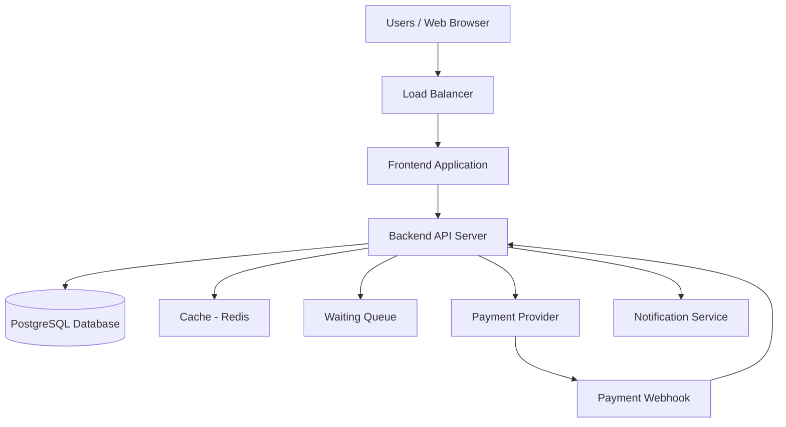

# TicketHub System Design

## 1. Requirements

### Functional Requirements

1. **User Registration and Login:** Users can create accounts and log in securely.
2. **Browse Events:** Users can view upcoming concerts and events, including dates, venues, prices, and ticket availability.
3. **View Seats:** Users can view available, held, and booked seats for an event.
4. **Hold Seats:** Users can temporarily reserve available seats while completing payment.
5. **Make Payments:** Users can pay for tickets using supported payment methods.
6. **Confirm Bookings:** The system confirms a booking only after successful payment.
7. **View Tickets:** Users can view and access their purchased tickets.
8. **Prevent Double-Booking:** The system must prevent two users from purchasing the same seat.
9. **Send Notifications:** Users receive booking confirmations and payment status updates.

### Non-Functional Requirements

## 2. Traffic Estimates

### Normal Day Traffic

- Registered users: 2,000,000
- Daily visitors: 50,000
- Pages viewed per visitor: 10
- Total page views per day: 50,000 × 10 = 500,000
- Tickets sold per day: 5,000

Assuming traffic is spread across 24 hours:

- Average page views per second: 500,000 ÷ 86,400 ≈ 5.8
- Average ticket sales per second: 5,000 ÷ 86,400 ≈ 0.06

### Big Sale Traffic

- People trying to buy tickets: 200,000
- Tickets available: 20,000
- Time period: 10 minutes (600 seconds)
- Average purchase attempts per second: 200,000 ÷ 600 ≈ 333
- Average tickets available per second: 20,000 ÷ 600 ≈ 33

### Comparison

The big sale creates a much higher demand in a short period. Approximately 200,000 people compete for only 20,000 seats, meaning there are 10 people competing for each seat.

The system must handle sudden traffic spikes using a waiting queue, caching, and load balancing. Seat reservations must be processed carefully to prevent double-booking.

The average rates above are estimates. Actual traffic may be much higher during the busiest seconds of the sale.

## 3. API Design

The TicketHub API allows users to browse events, view seats, reserve seats, make payments, and access purchased tickets.

| Method | Endpoint | Purpose |
|---|---|---|
| GET | /api/events | Browse all available events |
| GET | /api/events/:eventId | View details of a specific event |
| GET | /api/events/:eventId/seats | View seats and their availability |
| POST | /api/seat-holds | Temporarily hold available seats |
| POST | /api/payments | Initiate payment for a seat reservation |
| GET | /api/orders/:orderId | View booking and payment status |
| GET | /api/users/:userId/tickets | View tickets belonging to a user |

### API Endpoint Explanation

1. **Browse events:** `GET /api/events` returns a list of upcoming events, including names, dates, venues, and prices.

2. **View event details:** `GET /api/events/:eventId` returns detailed information about a selected event.

3. **View seats:** `GET /api/events/:eventId/seats` returns the seats for an event and indicates whether each seat is available, held, or booked.

4. **Hold seats:** `POST /api/seat-holds` requests a temporary reservation. The server checks seat availability and prevents another user from holding the same seat.

5. **Make payments:** `POST /api/payments` initiates payment for an existing seat hold. The system confirms the purchase only after verifying successful payment.

6. **View orders:** `GET /api/orders/:orderId` returns the order details and its current payment status.

7. **View tickets:** `GET /api/users/:userId/tickets` returns the authenticated user's purchased tickets.

### API Security and Reliability

- Protected endpoints require user authentication.
- The server validates all requests before processing them.
- Seat-hold requests use database transactions to prevent double-booking.
- Payment requests use idempotency keys to prevent duplicate payment processing.
- Seat holds expire automatically when payment is not completed within the allowed time.
- Users can access only their own orders and tickets unless they have authorized administrative permissions.

## 4. Database Design

TicketHub uses a relational database such as PostgreSQL to store users, events, seats, and orders.

### Table 1: Users

| Column | Type | Description |
|---|---|---|
| id | UUID | Primary key |
| full_name | VARCHAR | User's full name |
| email | VARCHAR | User's email address (unique) |
| password_hash | VARCHAR | Securely hashed password |
| created_at | TIMESTAMP | Account creation time |

### Table 2: Events

| Column | Type | Description |
|---|---|---|
| id | UUID | Primary key |
| name | VARCHAR | Event name |
| venue | VARCHAR | Event location |
| event_date | TIMESTAMP | Date and time of event |
| created_at | TIMESTAMP | Event creation time |

### Table 3: Seats

| Column | Type | Description |
|---|---|---|
| id | UUID | Primary key |
| event_id | UUID | Foreign key referencing Events |
| seat_number | VARCHAR | Seat identifier |
| price | DECIMAL | Ticket price |
| status | VARCHAR | Available, held, or booked |
| hold_expires_at | TIMESTAMP | Time when a temporary hold expires |

A unique constraint on (event_id, seat_number) ensures that a seat number exists only once per event.

### Table 4: Orders

| Column | Type | Description |
|---|---|---|
| id | UUID | Primary key |
| user_id | UUID | Foreign key referencing Users |
| seat_id | UUID | Foreign key referencing Seats |
| amount | DECIMAL | Amount charged |
| status | VARCHAR | Pending, paid, or cancelled |
| payment_reference | VARCHAR | Payment provider reference |
| created_at | TIMESTAMP | Order creation time |

A unique constraint on seat_id for confirmed orders prevents the same seat from being sold in multiple orders.

### Table Relationships

1. One user can create many orders (one-to-many).
2. One event can have many seats (one-to-many).
3. One seat belongs to one event (many-to-one).
4. One seat can be associated with an order, while each order belongs to one user.
5. Each order references a seat using seat_id.

### Database Integrity

- Primary keys uniquely identify records.
- Foreign keys prevent orders from referencing nonexistent users or seats.
- Unique constraints prevent duplicate seat records.
- Database transactions protect seat reservations and order creation from conflicting requests.

## 5. Preventing Double-Booking

TicketHub must ensure that only one user can successfully purchase a particular seat, even when thousands of users try to book tickets simultaneously.

### 1. Database Transactions

When a user requests a seat, the backend starts a database transaction.

- The database locks the requested seat row.
- The system checks whether the seat is available or its previous hold has expired.
- If available, the system creates a temporary seat hold and records its expiry time.
- The transaction commits the changes.
- If the seat is already held or booked, the request is rejected.

This ensures that concurrent requests cannot both reserve the same seat successfully.

### 2. Unique Constraints

The database enforces a unique constraint on (event_id, seat_number) in the Seats table.

This prevents duplicate seat records for the same event.

The system must also enforce that a seat cannot have more than one active or confirmed booking. This can be implemented using appropriate database constraints and transaction logic.

### 3. Temporary Seat Holds

When a user selects a seat, the system holds it for a limited period, such as 10 minutes.

- The hold includes an expiry timestamp.
- If payment succeeds, the booking is confirmed.
- If payment fails or the hold expires, the seat becomes available again.
- The system checks the expiry time using server-side logic, not the user's device clock.

### 4. Payment Verification

The booking is confirmed only after the payment provider verifies successful payment.

Payment callbacks must be authenticated, and idempotency keys prevent duplicate payment processing.

If payment succeeds after a hold expires, the system must safely reconcile the payment rather than sell the seat twice.

### 5. Handling Concurrent Requests

If two users attempt to reserve the same seat simultaneously:

1. The first transaction locks the seat and reserves it.
2. The second transaction waits for the lock or encounters a conflict.
3. After the first transaction commits, the second checks the updated seat status.
4. The second request is rejected if the seat is no longer available.

### Conclusion

Database transactions, row-level locking, unique constraints, temporary holds, and reliable payment verification work together to prevent double-booking. The database remains the source of truth for seat availability.

## 6. System Architecture

### Architecture Diagram



### Component Explanation

1. **Users / Web Browser:** Users browse events, select seats, and purchase tickets through the website.

2. **Load Balancer:** Distributes incoming requests across multiple backend servers to prevent one server from becoming overloaded.

3. **Frontend Application:** Displays event listings, seat availability, booking forms, and payment status.

4. **Backend API Server:** Processes requests, validates users, manages seat holds, creates orders, and coordinates payments.

5. **PostgreSQL Database:** Stores user accounts, events, seats, and orders. Transactions and database constraints protect booking accuracy.

6. **Redis Cache:** Stores frequently requested event information to reduce database load. Seat availability and final booking decisions are verified against the database.

7. **Waiting Queue:** Controls access during high-demand ticket sales and helps prevent the backend from being overwhelmed.

8. **Payment Provider:** Processes payments securely without requiring TicketHub to store sensitive card details.

9. **Payment Webhook:** Receives payment status notifications and allows the backend to verify and update orders.

10. **Notification Service:** Sends booking confirmations and payment updates to users.

### How the System Works

When a user visits TicketHub, the frontend requests event information from the backend. The backend retrieves cached information where appropriate and queries PostgreSQL when necessary.

When the user selects a seat, the backend uses a database transaction to reserve it temporarily. The user then completes payment through the payment provider. After successful payment is verified, the backend confirms the order and sends a notification.

During major ticket sales, the load balancer and waiting queue help manage traffic, while caching reduces unnecessary database requests.
```

### Step 3: Save

Press **Ctrl + S**.

**Important:** The architecture diagram is written in Mermaid. If it doesn't display as a diagram inside VS Code, don't worry — it can still be rendered by compatible Markdown preview tools.

When you're done, tell me **“Task 6 done”** and we'll tackle Task 7: design trade-offs. 🚀

## 7. Design Trade-offs

### Trade-off 1: Strong Consistency vs. High Performance

TicketHub must decide between prioritizing accurate seat availability and maximizing response speed.

- **Option A — Strong consistency:** Use PostgreSQL transactions and row-level locks when reserving seats. This prevents two users from successfully booking the same seat.
- **Option B — Higher performance:** Rely heavily on caching to serve seat availability information faster, but cached information may become outdated.

**Decision:** TicketHub will prioritize strong consistency for seat reservations and payments. Redis caching will be used for event listings and other information that does not require real-time accuracy.

**Reason:** Selling the same seat twice would damage customer trust. Slightly slower booking operations are preferable to incorrect reservations.

### Trade-off 2: Immediate Access vs. A Waiting Queue

TicketHub must decide whether every visitor can access the booking system immediately or whether visitors should wait in a queue during major sales.

- **Option A — Immediate access:** Users can attempt to purchase tickets immediately, but sudden traffic spikes may overwhelm the servers.
- **Option B — Waiting queue:** Users wait for their turn, reducing pressure on the backend but making some customers wait longer.

**Decision:** TicketHub will use a waiting queue during high-demand sales and allow normal access when traffic is manageable.

**Reason:** A waiting queue helps protect the system from overload and gives the booking service a better chance of remaining stable during popular events.

### Conclusion

TicketHub prioritizes booking accuracy and system stability while using caching and controlled access to improve performance. These choices balance customer experience, reliability, and scalability.

1. **Speed:** Event pages and seat maps should load quickly, ideally within 2 seconds under normal traffic.
2. **Correctness:** A seat must never be sold to two different users. Bookings and payments must be processed reliably.
3. **Fairness:** Users should be treated fairly during popular ticket sales. The system should use a waiting queue to manage heavy traffic.
4. **Scalability:** The system must handle 50,000 daily visitors and sudden spikes of up to 200,000 people trying to buy tickets.
5. **Availability:** The system should remain accessible during high-demand events and recover quickly from failures.
6. **Security:** User accounts and payment information must be protected using authentication, encryption, and secure payment processing.
7. **Reliability:** Failed payments should not result in confirmed bookings, and users should receive accurate booking status updates.
8. **Maintainability:** The system should use separate components that can be updated and maintained independently.
